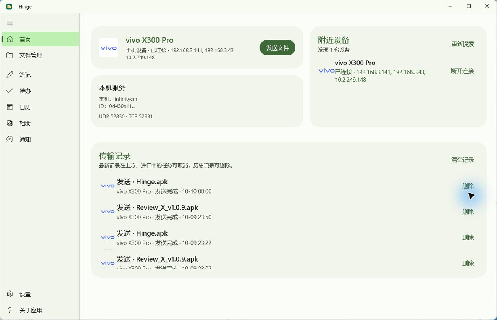
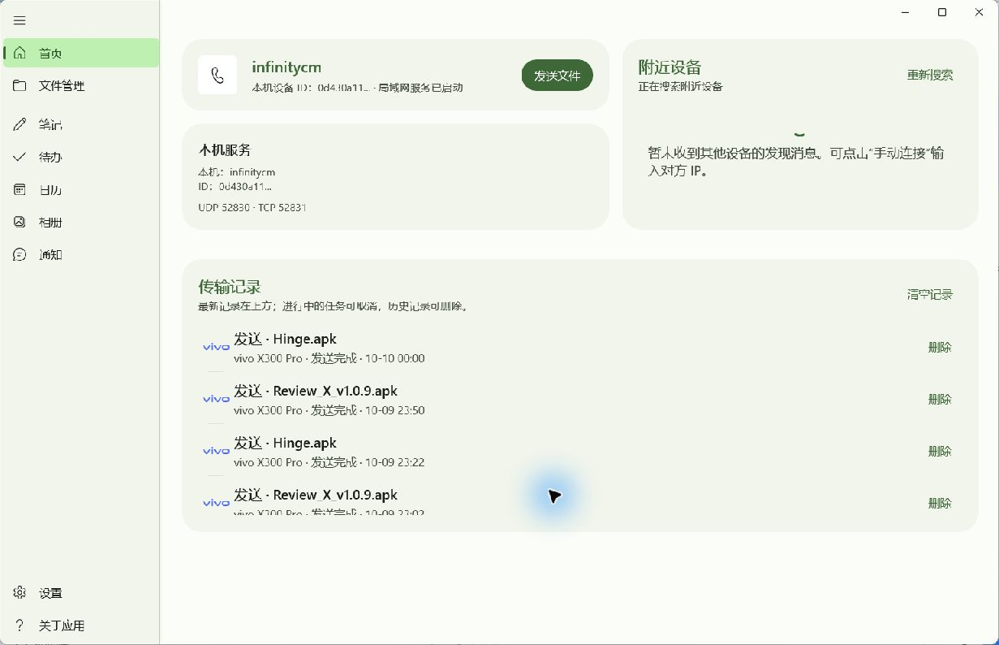

# Hinge Windows 融合式标题栏验收（2026-10-10）

## 改造范围

本轮只修改 `windows/Hinge.App/MainWindow.xaml` 和 `MainWindow.xaml.cs`。删除独立 AppTitleBar 及根布局顶部行，NavigationView 从客户区顶部开始；局部消除 NavigationView 内容顶边框与圆角。主内容保留系统标题按钮高度的顶部留白，没有新增标题栏卡片或全局主题系统。

保留 ExtendsContentIntoTitleBar，移除旧 SetTitleBar(AppTitleBar)，使用 Windows App SDK InputNonClientPointerSource.SetRegionRects 的 Caption 区域。空白顶部可拖动；48 DIP 菜单区域、侧栏分界两侧和系统按钮 inset 被排除。XamlRoot 缩放、窗口尺寸/状态、侧栏宽度变化时重新换算物理像素区域。沿用原生系统按钮与现有 M3 颜色映射，新增主题变化刷新和关闭时事件解绑。

本轮没有改传输协议、BLE、ADB、文件管理、托盘业务或既有窗口消息处理。工作树原有其他改动保留，因此 Git 相对 HEAD 的完整 diff 不等于本轮改动；本轮对照下述 source 快照核对。

## 改造前后

改造前来自用户原有 Debug 实例，改造后来自隔离单实例键的 Release 候选。两个实例的在线设备和传输记录不同，不能把数据内容差异视作此次布局变更。

## 实际交互验收

| 项目 | 结果与证据 |
| --- | --- |
| 独立 Hinge 顶栏、导航起点 | 通过；旧图标/标题横条消失，菜单从顶部开始，见前后截图 |
| 鼠标拖动 | 通过；拖动顶部空白后截图物理原点从 (510,190) 移至 (585,253) |
| 双击最大化/还原 | 通过；普通窗口 1231×794 逻辑像素与最大化 2048×1104 相互切换；原生 Restore 控件出现 |
| 原生最大化按钮 | 通过；点击后最大化，见 after-maximized-0.png |
| 原生最小化按钮 | 通过；截图 API 返回 window is minimized，随后再次启动恢复同一窗口 |
| 原生关闭按钮 | 通过隐藏到托盘；窗口从可用窗口列表消失，候选进程存活，生命周期日志记录 window-close-hidden-to-tray |
| 托盘隐藏后再次启动 | 未通过确认；再次启动后窗口没有重新出现在可用窗口列表。未修改这段既有激活业务，不宣称恢复功能已验收 |
| 菜单、导航及顶部页面交互 | 已验证菜单收起、设置导航、个性化主题单选与配色下拉可点；未逐页遍历全部操作 |
| 侧栏宽度拖动 | 通过；200 拖至 UIA 299.200012；收起后为紧凑栏，见 after-pane-resized-0.png、after-pane-collapsed-0.png |
| Windows Snap Layouts | 未完成实际弹出与吸附验收；仍使用原生最大化按钮，没有自绘按钮 |
| 文件拖入 | 保留原有根节点及内容拖放绑定；未实际拖入/传输验收 |
| DPI | 当前桌面截图验收完成；100%/150% 未实测。尝试读取 Windows 显示设置时工具应用授权超时，未切换系统缩放，不宣称完成三档矩阵 |
| 缩窄窗口 | 未完成；边框拖动未改变捕获尺寸。普通窗口与最大化实测完成 |
| 浅色、深色、主题色 | 已实测鼠尾草绿深色、紫色深色/浅色，无独立顶部色条，见下方截图；结束前恢复“跟随系统＋鼠尾草绿” |

更多截图：[最大化](visual-acceptance/20261010-integrated-titlebar/after-maximized-0.png)、[侧栏拖宽](visual-acceptance/20261010-integrated-titlebar/after-pane-resized-0.png)、[收起导航](visual-acceptance/20261010-integrated-titlebar/after-pane-collapsed-0.png)、[深色鼠尾草绿](visual-acceptance/20261010-integrated-titlebar/after-dark-0.png)、[紫色深色](visual-acceptance/20261010-integrated-titlebar/after-purple-dark-0.png)、[紫色浅色](visual-acceptance/20261010-integrated-titlebar/after-purple-light-0.png)。

## 构建及检查

- Release x64 构建成功，0 警告/0 错误；正式发布、Shell、身份 MSIX、安装器与 ZIP 构建成功。日志：`tmp/titlebar-build.log`、`tmp/titlebar-windows-package.log`。
- Caption 几何模型覆盖 180 组 DPI/宽度/侧栏/inset 组合，区域边界与互斥断言通过；源码留有 Debug.Assert。此项属于计算检查，不是 Windows DPI 实测。
- scoped CRLF-aware diff --check 通过；未运行无关的全量测试。
- GUI 候选仅临时使用 Hinge.TitleBarVerification 单实例键，App.xaml.cs 构建后按字节还原。正式 ZIP 的 Hinge.dll 包含 Hinge.Main，不含候选键；用户原 Debug 实例保留运行。清理仅针对本轮候选路径。
- ZIP 807 项完整性通过，DLL 与正式发布输出一致；安装器内嵌 ZIP 与独立 ZIP 一致。安装器 Authenticode 为 NotSigned，可能出现 Windows 未知发布者提示。
- 按项目规程重建签名 Android ARM64 主线 APK，Android 源码未改；v2/v3 签名验证通过。

| 产物 | Bytes | SHA-256 |
| --- | ---: | --- |
| publish/windows/Hinge-Setup.exe | 198272993 | 77649D912B9FBF29A61CCA0D1FBA43BD25411C3024BBCDA837F8C4B662207CD9 |
| publish/windows/Hinge-Windows.zip | 129889438 | 8885542E252A065E766A302EEC988291A45583E2941E6CEDE8E1E09010711851 |
| publish/Hinge.apk | 21159073 | B9A370CE39C3BC424F799514F9ADDB2BA36129FD85EF2DDFD9D44D4C1A2E30B3 |

正式 Hinge.dll SHA-256：92E5EB6FC520CD23CEF90CB703CD63EB01B39BCAB13E44816C43FAB791F54306。

## 回退

快照：`publish/rollback/pre-integrated-titlebar-20261010/`。source 保存改前 MainWindow.xaml、MainWindow.xaml.cs 和 App.xaml.cs；packages 保存上一版 Windows 安装器、ZIP 和 APK；docs 保存改前开发文档。只恢复本轮对应目标文件与包，不重置整个工作树。源码回退后重新构建；安装验收不通过可使用 packages 中上一版安装器。没有提交或推送。

## 平台依据与限制

使用 [Microsoft 自定义标题栏文档](https://learn.microsoft.com/en-us/windows/apps/develop/title-bar) 的系统标题按钮、Caption 区域及 DIP/物理像素换算机制；[SetDragRectangles 文档](https://learn.microsoft.com/en-us/windows/windows-app-sdk/api/winrt/microsoft.ui.windowing.appwindowtitlebar.setdragrectangles?view=windows-app-sdk-2.0) 指向更新的 InputNonClientPointerSource API。本地 WinApp CLI 0.7.1 的项目 API 检索确认 SetRegionRects 可用，没有新增应用依赖。

当前结果是代码与发布包完成、主要交互实测通过；由于上述剩余项，尚不能声明用户要求的全部验收完成。GUI 点击后需重新取稳定帧再保存截图，避免将过渡帧误判为布局结果；工具授权超时不得记录为实测通过。
